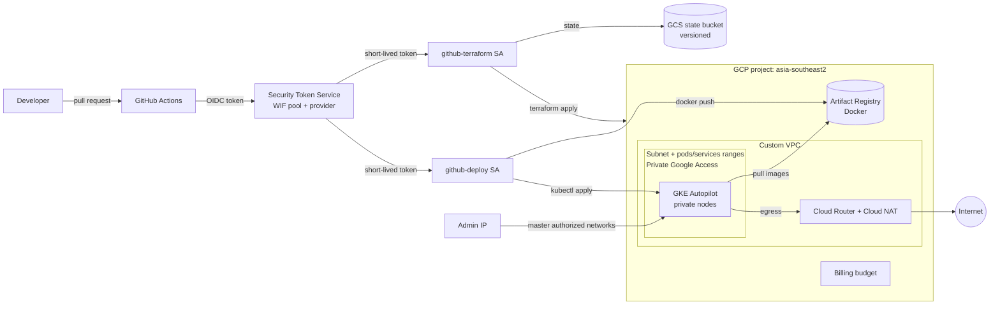

# gcp-platform-terraform

Terraform for a production-style **Google Cloud foundation for containerized apps**: a private GKE Autopilot cluster in its own VPC, an Artifact Registry for images, and keyless GitHub Actions CI/CD through Workload Identity Federation. There are separate **dev** and **prod** environments built from the same small modules. The default region is `asia-southeast2` (Jakarta).

> Status: portfolio / reference project. Formatting, validation, linting and security scanning run in CI. Nothing here has been applied against a real project as part of this repository; see [Verification](#verification).

## What it builds

| Module | Resources |
|--------|-----------|
| [`network`](modules/network) | Custom-mode VPC, subnet with `pods`/`services` secondary ranges, Private Google Access, Cloud Router + Cloud NAT, firewall basics |
| [`gke`](modules/gke) | Private **GKE Autopilot** cluster: private nodes, master authorized networks, release channel, Workload Identity, dedicated node SA, deletion protection |
| [`artifact-registry`](modules/artifact-registry) | Docker repository with cleanup policies |
| [`github-oidc`](modules/github-oidc) | Workload Identity pool and provider locked to one GitHub repo, a **deploy** SA and a **Terraform** SA (no keys) |
| [`budget`](modules/budget) | Optional monthly billing budget with alert thresholds |

Each environment (`envs/dev`, `envs/prod`) also enables the required project APIs with `google_project_service`. `bootstrap/` creates the GCS bucket that holds the remote state.

### dev vs prod

| Setting | dev | prod |
|---------|-----|------|
| GKE deletion protection | off | **on** |
| Release channel | `REGULAR` | `STABLE` |
| VPC flow logs | off | on |
| Artifact Registry immutable tags | off | **on** |
| Image versions kept | 5 | 20 |
| Pod range | `/16` | `/14` |
| Default budget (if enabled) | 100 USD | 500 USD |
| CI apply | automatic on merge | after a **required reviewer** approves |

## Architecture



## Repository layout

```
bootstrap/            # one-time: GCS state bucket and per-env state access
envs/dev, envs/prod   # root modules: APIs + module wiring, GCS backend
modules/              # network, gke, artifact-registry, github-oidc, budget
.github/workflows/    # fmt / validate / tflint / checkov, plan on PR, apply on main
```

## Prerequisites

- A GCP project per environment (for example `my-project-id-dev` and `my-project-id-prod`) with billing enabled. A single project works too.
- Owner (or an equivalent set of admin roles) on those projects for the **first** apply, which you run locally
- [Terraform](https://developer.hashicorp.com/terraform/install) >= 1.9 (tested with 1.15) and the [gcloud CLI](https://cloud.google.com/sdk/docs/install)
- Optional: [tflint](https://github.com/terraform-linters/tflint) and [Checkov](https://www.checkov.io/) for `make lint` / `make scan`

```bash
gcloud auth login
gcloud auth application-default login
```

## Getting started

### 1. Bootstrap the state bucket

```bash
cd bootstrap
cp terraform.tfvars.example terraform.tfvars   # set project_id and a globally unique bucket_name
terraform init
terraform apply
```

The bucket has versioning, uniform bucket-level access, public access prevention set to `enforced`, and `prevent_destroy`. Bootstrap keeps its own state **locally** because it creates the bucket that would otherwise hold that state. Keep `bootstrap/terraform.tfstate` somewhere safe, or move it into the bucket afterwards: add a `backend "gcs" { prefix = "bootstrap" }` block and run `terraform init -migrate-state`.

### 2. Configure an environment

```bash
cd envs/dev
cp backend.hcl.example backend.hcl                 # bucket = "<bucket from step 1>"
cp terraform.tfvars.example terraform.tfvars       # project_id, github_repository, your IP
```

`master_authorized_networks` decides who can reach the Kubernetes API. Use your own public IP as a `/32`. If the list is empty, nothing outside Google can reach it.

### 3. Plan and apply dev

```bash
make plan ENV=dev                       # init with backend.hcl + plan -out=tfplan
terraform -chdir=envs/dev apply tfplan
```

Creating the cluster takes roughly 10 minutes. Then:

```bash
$(terraform -chdir=envs/dev output -raw get_credentials_command)
kubectl get ns
```

### 4. Let CI take over

1. Grant each environment's Terraform SA access to **its own** state prefix. Add it to `state_writers` in `bootstrap/terraform.tfvars`, then run `terraform apply` in `bootstrap/` again:
   ```hcl
   state_writers = {
     "envs/dev" = "serviceAccount:github-terraform@my-project-id-dev.iam.gserviceaccount.com"
   }
   ```
2. In GitHub, go to **Settings → Secrets and variables → Actions → Variables** and add these repository variables. None of them are secrets.

   | Variable | Value |
   |----------|-------|
   | `TF_STATE_BUCKET` | bucket name from step 1 |
   | `DEV_GCP_PROJECT_ID` / `PROD_GCP_PROJECT_ID` | project IDs |
   | `DEV_WIF_PROVIDER` / `PROD_WIF_PROVIDER` | output `workload_identity_provider` |
   | `DEV_TF_SERVICE_ACCOUNT` / `PROD_TF_SERVICE_ACCOUNT` | output `terraform_service_account_email` |

3. In **Settings → Environments**, create `dev` and `prod`. On `prod`, enable **Required reviewers**, add yourself or your team, and restrict deployment branches to `main`.

Repeat steps 2–4 for `envs/prod`.

## CI/CD workflow

[`.github/workflows/terraform.yml`](.github/workflows/terraform.yml)

| Trigger | Job | What it does |
|---------|-----|--------------|
| PR and push | `checks` (bootstrap, dev, prod) | `terraform fmt -check`, `init -backend=false`, `validate`, `tflint` (google ruleset), Checkov |
| PR (same repo) | `plan` (dev, prod) | Authenticates through WIF, runs `terraform plan`, and posts or updates one plan comment per environment on the PR |
| push to `main` | `apply-dev` | Plans and applies dev (GitHub environment `dev`) |
| after `apply-dev` | `apply-prod` | Waits for approval on the protected `prod` environment, then plans and applies prod |

Permissions are least-privilege. The workflow default is `contents: read`. Only the jobs that authenticate to GCP get `id-token: write`, and only `plan` gets `pull-requests: write`. PRs from forks skip `plan` because GitHub doesn't give them an OIDC token.

## How GitHub OIDC works (and why there are no keys)

1. On every run, GitHub can issue a short-lived **OIDC token**, a JWT signed by `token.actions.githubusercontent.com`. It carries claims such as `repository`, `repository_owner`, `ref` and `sub`.
2. `google-github-actions/auth` sends that token to Google's **Security Token Service**. The Workload Identity **provider** checks the signature and evaluates the `attribute_condition`:
   ```
   assertion.repository_owner == 'rakaprad' && assertion.repository == 'rakaprad/gcp-platform-terraform'
   ```
   A token from any other repository is rejected at this point.
3. The resulting federated identity holds `roles/iam.workloadIdentityUser` on the service account, granted only to `principalSet://…/attribute.repository/<owner>/<repo>`. It impersonates the SA and gets an access token that expires after about an hour.

Nothing has to be stored, rotated or revoked, and nothing can leak. JSON service account keys are long-lived bearer credentials, and they are one of the most common causes of GCP compromises. With federation, a stolen credential is only good until it expires, and it can only be minted by a workflow running in this repository.

## Security decisions

| Decision | Why |
|----------|-----|
| Workload Identity Federation, no SA keys | No long-lived secrets in GitHub; access is tied to one repo by an attribute condition |
| Separate **deploy** and **Terraform** SAs | App pipelines can push images and deploy workloads, but they can't change infrastructure |
| Deploy SA: `artifactregistry.writer` on **one repo** + `container.developer` | Least privilege: no project-wide registry access, and no changes to cluster config or RBAC |
| Terraform SA: scoped admin roles, never `owner`/`editor` (enforced by variable validation) | Smaller blast radius than a basic role |
| State access per prefix, using IAM conditions in `bootstrap/` | The dev pipeline can't read or overwrite prod state. The SA also never needs permission to edit bucket IAM |
| Private nodes + Cloud NAT | Nodes have no public IPs. Egress goes through NAT |
| Master authorized networks, `gcp_public_cidrs_access_enabled = false` | Only listed CIDRs can reach the API server, not "anything in Google Cloud" |
| Dedicated node SA (`container.defaultNodeServiceAccount`) | Avoids the default Compute SA, which often has Editor |
| Private Google Access | Nodes reach Google APIs over Google's network without public IPs |
| Autopilot | Shielded nodes, Workload Identity, Dataplane V2 / NetworkPolicy and the GKE metadata server are always on |
| State bucket: versioning, uniform access, public access prevention, `prevent_destroy` | State often contains sensitive values and must be recoverable |
| Deletion protection + immutable tags in prod | Guards against accidental `destroy` and tag overwrites |
| Protected `prod` GitHub environment | A human approves every prod apply |
| Checkov in CI with inline, justified skips | Every skipped check sits next to the code with a written reason |

Known trade-off: the Terraform SA has `iam.serviceAccountAdmin`, `iam.serviceAccountUser` and `resourcemanager.projectIamAdmin`, because it manages service accounts and IAM. Anyone who can run the workflow therefore has a lot of power. This is mitigated by the WIF repo condition, branch protection and the reviewer gate on prod. See the roadmap for further hardening.

## Estimated monthly cost (dev)

> **Estimate only.** Prices change and differ by region. Check the [GCP pricing calculator](https://cloud.google.com/products/calculator) for `asia-southeast2` before relying on these numbers.

| Item | Rough monthly cost |
|------|--------------------|
| GKE Autopilot cluster fee (~USD 0.10/h) | ~USD 73, but the GKE free tier credit (USD 74.40/month per billing account) normally covers **one** Autopilot cluster |
| Autopilot pod resources (billed on pod requests; ~0.5 vCPU + 2 GiB running 24/7) | ~USD 20–35 |
| Cloud NAT (gateway per VM-hour + per-GB processing) | ~USD 2–10 at low traffic |
| Artifact Registry (first 0.5 GB free) | < USD 1 |
| GCS state bucket, Cloud Router | cents / free |
| Logging (first 50 GiB/project free; flow logs off in dev) | ~USD 0 |
| **Total** | **~USD 25–50 / month** with a small workload. Close to zero with no pods running, once the free tier covers the cluster fee |

Prod costs more because of the second cluster fee (the free tier covers only one cluster per billing account), flow logs and real workloads.

## Teardown

Destroy the environments first, because their state lives in the bucket. Destroy the bucket last.

```bash
# dev
terraform -chdir=envs/dev destroy

# prod: deletion protection must be switched off and applied first
#   envs/prod/main.tf -> module "gke" { deletion_protection = false }
terraform -chdir=envs/prod apply
terraform -chdir=envs/prod destroy

# state bucket: remove the `prevent_destroy` lifecycle block in bootstrap/main.tf, then
gcloud storage rm --recursive gs://<bucket>/**   # bucket has force_destroy = false
terraform -chdir=bootstrap destroy
```

Notes:
- Workload Identity **pools are soft-deleted for 30 days**. If you recreate the environment within that window, either undelete the pool (`gcloud iam workload-identity-pools undelete github --location=global`) or set a different `pool_id`.
- `google_project_service` uses `disable_on_destroy = false`, so APIs stay enabled after a destroy.

## Local commands

```bash
make help
make fmt          # terraform fmt -recursive
make fmt-check
make validate     # init -backend=false + validate for bootstrap, dev, prod
make lint         # tflint with the google ruleset
make scan         # checkov
make plan ENV=dev
make clean        # remove .terraform/ and plan files
```

## Verification

These were run locally against this repository with Terraform 1.15.5, hashicorp/google 8.6.0, tflint 0.64.0 (google ruleset 0.40.0), Checkov 3.3.28 and actionlint:

- `terraform fmt -check -recursive`: pass
- `terraform init -backend=false && terraform validate` in `bootstrap/`, `envs/dev`, `envs/prod`: pass
- `tflint` in all three roots, including the local modules they call: no issues
- `checkov -d . --framework terraform`: 0 failed (skipped checks are justified inline)
- `actionlint` on the workflow: pass

Not verified: `terraform plan` / `apply` against a real project, the IAM role set being exactly enough for CI, and the PR comment flow on GitHub. All of these need a real GCP project and repository.

## Roadmap

- Separate **plan** (read-only) and **apply** SAs, and bind the prod apply SA to the `environment:prod` OIDC subject
- Pin GitHub Actions to commit SHAs and add Dependabot for actions and providers
- Pin WIF to immutable `repository_id` / `repository_owner_id` claims, so a renamed or recreated repository with the same name can't match
- CMEK (Cloud KMS) for Artifact Registry and the state bucket
- Binary Authorization and Google Groups for GKE RBAC
- Infracost comment on PRs
- An example app repo that uses the deploy SA to build, push and roll out

## License

[MIT](LICENSE) © 2026 Raka Pradipta
